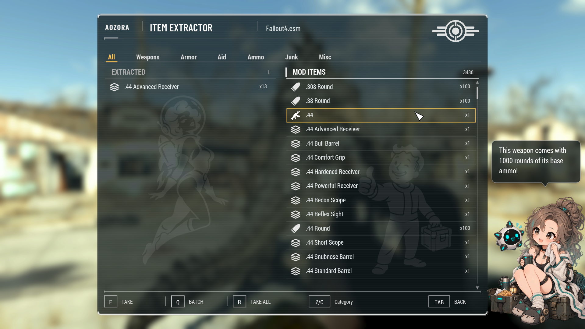
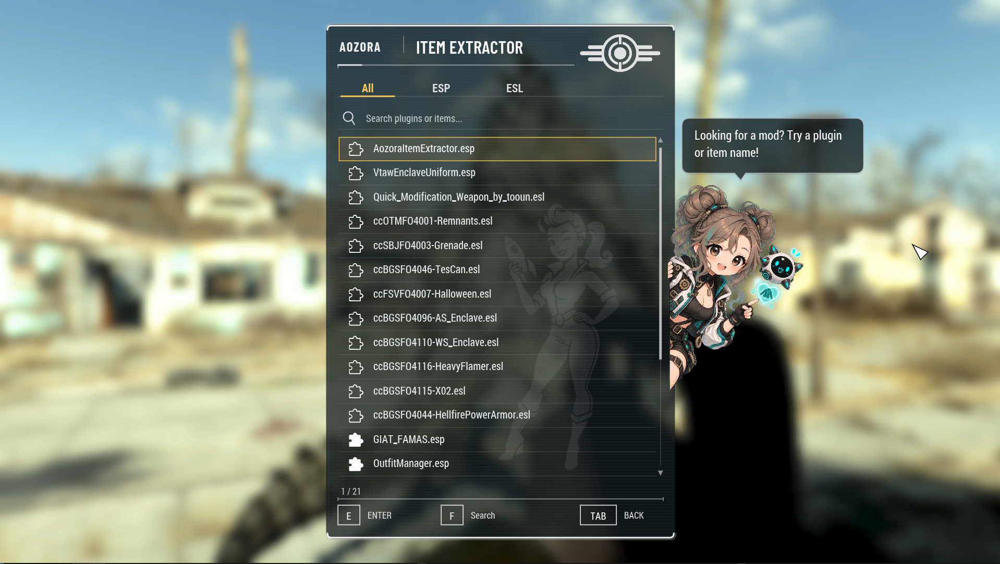
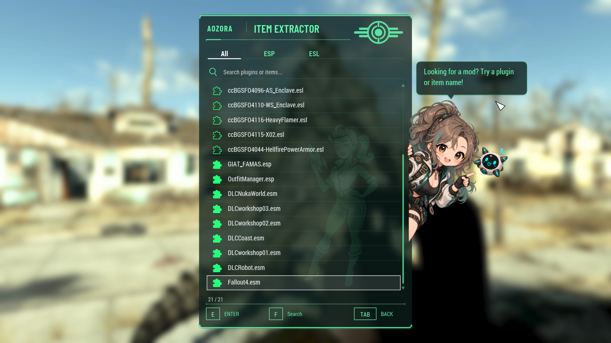
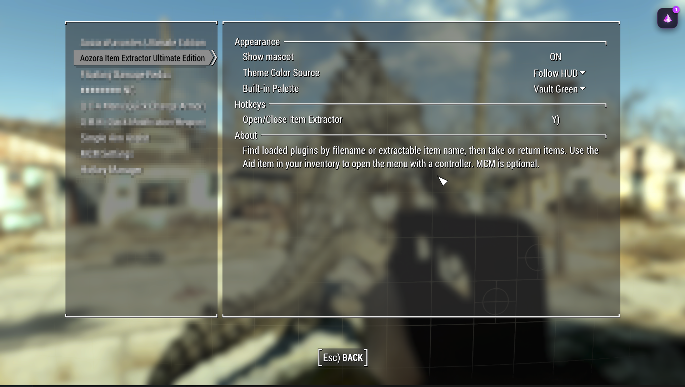

<div align="center">

# Aozora Item Extractor Ultimate Edition
### 青空物品提取器终极版

**Aozora 风格界面 · 键鼠与手柄 · 社区实用功能**

[](https://github.com/AozoraCynthiAStudio/Aozora-Item-Extractor-Ultimate-Edition/releases/latest)


[下载 / Downloads](https://github.com/AozoraCynthiAStudio/Aozora-Item-Extractor-Ultimate-Edition/releases/latest) · [English](docs/README_EN.md) · [构建说明](docs/BUILD.md) · [许可](LICENSE.md)

</div>

## 这是什么？

用于 Fallout 4 的模组物品提取器。采用 **Aozora 风格界面**，支持 **键鼠与手柄**，并借鉴社区同类工具中成熟、实用的功能，将查找、提取和归还整理为一致的双栏操作体验。

**English:** A Fallout 4 item extractor with an Aozora-styled UI, keyboard/mouse and controller support, and practical features inspired by community item extractors. [Read the full English description](docs/README_EN.md).

当前版本为 **v1.0.5**：新增鼠标拖动滚动条与手柄右摇杆滚动，并提升中文输入模组兼容性。内部插件名、脚本及表单标识沿用原实现。

## 界面预览



<details>
<summary>插件搜索、HUD 配色、批量选择与 MCM</summary>






</details>

截图由游戏内拍摄；部分截图来自打磨过程，手柄分类键在当前版本为 **LT/RT**。

## 功能

| 功能 | 实际行为 |
|---|---|
| 插件发现 | 扫描已加载 ESM / ESP / ESL，隐藏没有可提取物品的插件，按加载顺序倒序显示 |
| 物品名搜索 | 不知道物品属于哪个插件时，可输入物品名查找对应插件；进入后将匹配项置于列表顶部并保护初始焦点 |
| 双栏操作 | 右栏显示当前插件物品，左栏显示本次菜单会话的可归还物品 |
| 提取与归还 | 单次按组、批量指定数量、全部操作；底部提示随焦点栏位切换 |
| 武器弹药 | 有基础弹药的武器，每次操作默认附送1000发；MCM可调整或关闭 |
| 输入适配 | 键鼠和手柄；搜索需点击或按指定键进入输入模式 |
| 主题与装饰 | 跟随 HUD 或六种配色；水印、随机角色与提示气泡；MCM 可同时关闭角色和气泡 |
| 汉化 | 独立简体中文补丁；品牌和主标题保留英文；物品名称沿用游戏/模组数据 |
| 启动方式 | MCM 热键，或 Pip-Boy“辅助”分类中的启动物品；MCM 为可选依赖 |

支持武器、护甲、弹药、辅助物品、书籍、便条、钥匙和杂项物品；含组件的杂项归为垃圾。扫描结果受可携带物品过滤规则限制，并非所有插件记录都可提取。

## 数量规则：单次按组，批量按指定数量

默认组大小来自 `Data/F4SE/Plugins/AozoraItemExtractor.ini`：

| 类别 | 普通提取一次 | 配置键 |
|---|---:|---|
| 武器 | 1 | Weapon |
| 投掷武器（含手雷等） | 1 | Grenade |
| 护甲 | 1 | Armor |
| **弹药** | **100** | Ammo |
| 辅助物品 | 1 | Aid |
| 垃圾 | 1 | Junk |
| 杂项、书籍、便条、钥匙 | 1 | Misc |

- **E / 手柄 A：** 提取或归还当前物品的一组。例如默认弹药一次提取 100 发，并非 1 发。
- **Q / 手柄 Y：** 选择实际数量，**不是组数**。选择 x10 弹药即为 10 发；常用档位为 1、10、50、100、1000，并按可归还数量调整。
- **R / 手柄 X，右栏：** 当前插件的全部可提取物品各取一组，**不只处理当前分类**。大量物品分批加入。
- **R / 手柄 X，左栏：** 归还本次菜单会话的全部可归还物品，**不只处理当前分类**；包括该会话在不同插件页面提取的物品。

### 武器附送弹药

武器记录具有基础弹药时，**每次提取操作默认附送1000发**，可在MCM调整或设为0关闭。批量提取多把枪也只附送一组，不按武器数量倍增。没有基础弹药的近战、投掷武器等不会附送。

**赠送弹药不单独计入已提取清单，归还武器不会自动收回赠送弹药。** 若同种弹药也被手动提取，归还仍受该弹药的会话净提取量约束。

### 归还与会话

左栏不是整个背包。它仅显示本次会话中仍可归还的提取物品。每种物品首次提取前记录背包数量，归还不超过“本次净提取量”与“当前背包超过基线的数量”两者中的较小值。已消耗、丢弃等数量可能无法归还。

从提取页返回插件页不会清空会话；关闭整个菜单会结束会话。关闭菜单不会自动删除已提取物品，再次打开后也不能通过旧清单归还。

## 操作

| 操作 | 键盘 | 手柄 |
|---|---|---|
| 进入插件 / 提取 / 归还 | E | A |
| 上下选择 | W/S 或 ↑/↓ | 方向键上下 / 左摇杆 |
| 左右栏切换 | A/D 或 ←/→ | 方向键左右 / 左摇杆 |
| 分类切换 | Z/C | **LT/RT** |
| 搜索（插件页） | F 或点击搜索栏 | Y |
| 批量（提取页） | Q | Y |
| 全部提取 / 全部归还 | R | X |
| 返回 | Tab | B |
| 数量弹窗选择 | A/D 或 ←/→ | 方向键左右 |

搜索模式下输入文字，Enter、Tab 或 Esc 可退出输入。鼠标可点击分类、物品和数量选项。

## 安装

1. 安装与游戏版本匹配的 **F4SE**、**Address Library for F4SE Plugins** 和 VC++ x64 运行库。
2. 在 Releases 下载英文主体，用 MO2 等管理器安装并启用 `AozoraItemExtractor.esp`（ESL 标记）。
3. 如需中文，再安装 **CHS Patch**，让它覆盖英文主体即可汉化。需要中文字体环境。
4. 通过 F4SE 启动游戏、加载存档，在 MCM 绑定热键或使用背包中的启动物品。

MCM / F4MCM 可选。汉化补丁覆盖完整功能文字及同名 ESP 的启动物品显示名，不增加插件槽位。主菜单标题仍为 AOZORA / ITEM EXTRACTOR；中文 MCM 名称为“青空物品提取器终极版”。

代码声明支持 OG、NG 和 AE 的多个运行版本；这不代表每个游戏版本及整合包都已实测。当前版本在用户测试环境中验证，LT/RT 分类切换已编译，实机确认仍待进行。

## 源码与致谢

```text
src/as3/       AS3 菜单与界面输入
src/native/    CommonLibF4 原生插件
Data/          当前运行文件与 Papyrus 源码
mcm/           MCM 配置
assets/        图标、字体、角色及水印
translations/  英文 / 中文翻译表
发布物料/       游戏截图
tools/         构建与打包工具
```

源码开放供非商业使用，见 [LICENSE](LICENSE.md)。构建见 [BUILD](docs/BUILD.md)，语言与素材说明见 `docs/`。第三方 SDK 不随源码包分发。

- [In-Game-Mod-Explorer](https://github.com/Perchik71/In-Game-Mod-Explorer)：参考已加载插件枚举、轻量插件归属、物品过滤和缓存生命周期思路。
- Aozora Favorites：同系列界面、图标和操作风格参考。
- Barlow Condensed：标题字体，SIL Open Font License。

详细许可及使用范围见 [THIRD_PARTY_NOTICES](THIRD_PARTY_NOTICES.md)。


## v1.0.4：重要修复与新增设置

v1.0.3 打包时误将实验性3D预览代码编入DLL，造成进入提取页后保存CTD。这是打包疏漏，正式构建已移除实验代码，并增加构建/打包检查。用户已在AE确认保存恢复正常及新增MCM设置可用。

- 武器附赠弹药：滑块0–1000，步长100，默认1000；0关闭。
- 弹药每组数量：左右切档1 / 10 / 50 / 100 / 500 / 1000，默认100。
- INI自定义：`[ItemCount] Ammo`、`WeaponAmmo`；更改MCM选择会覆盖INI自定义，下次打开提取菜单生效。只打开MCM不会覆盖。
- 搜索输入模式：更明显的边框、底色与“输入中”提示；Tab、Enter退出输入并保留查询。


## v1.0.5：滚动与中文输入兼容

支持鼠标拖动滚动条、点击轨道翻页，以及右摇杆滚动当前焦点所在列表。滚动后选中行完整可见。搜索输入已通过 Chinese Input（RIME）和 NA Input Support 测试；其他输入模组欢迎留言反馈。
